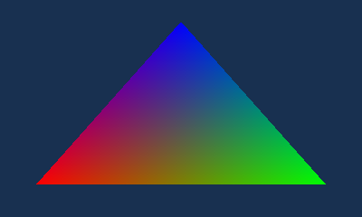

# Native triangle acceptance — 2026-10-13

Passed in **Azahar 2126.1.2**, Vulkan/MoltenVK, 1x resolution, guest CPU 100%,
CPU and shader JIT enabled. See `environment.json` for toolchains, reference
commit and tested binary hashes. No actual 3DS was available; the user explicitly
accepted Azahar for this stage.

## Results

- Seven Rust tests: command encoding, bounds, alignment, float format, every
  allocation-failure rollback, lifecycle, overflow recovery and state restoration.
- C and C++ host ABI tests and devkitPro ARM hard-float builds passed.
- Native executable symbol audit: no Citro3D, GPUCMD, DVLB or shaderProgram helpers.
- Three full native C runs plus one C++ run: **2,764 native GPU frames**, including
  **32 checked init/close cycles**, alternating clear colors, colored pixel checks,
  and exact linear/VRAM free-space recovery. The VRAM allocator is primed before
  measuring because libctru initializes its pool lazily.
- Three C-reference runs, using its persistent indexed VBO GPU cache.
- Every complete 400×240 displayed GPU image from all seven runs is byte-identical.
  PPM SHA-256: `8dda7aac9018e31727a3314a72d4870a3ef3f40cf26bffe3f7f996381421fb8a`.



## Performance

Each load has 30 warmup frames and 120 measured frames per run. CPU work excludes
explicit GPU/VBlank waiting. Both implementations synchronize at 60 Hz; total
latency is about 16.712 ms/frame. The C implementation tracks its waits with
`c3dglGetGpuWaitMs`; native CPU timing begins after its wait. This avoids claiming
its presentation wait as useful CPU work. The table compares the **slowest native
run** to the **fastest reference run**, not favorable individual samples.

| Triangle draws/frame | C/Citro3D CPU ms | Native CPU ms | CPU reduction |
| ---: | ---: | ---: | ---: |
| 1 | 0.4244 | 0.3337 | 21.4% |
| 64 | 1.5869 | 0.4010 | 74.7% |
| 512 | 9.8531 | 0.8789 | 91.1% |

All three CPU performance gates pass. Azahar's GPU timing is essentially constant
at 0.2494–0.2495 ms here and cannot establish PICA hardware execution speed. These
results establish this native triangle workload's emulated CPU advantage, not a
general performance claim for the future full OpenGL port or physical 3DS.

## Repeat

From the repository root, run `native/scripts/check.sh`, then:

```
python3 native/scripts/emulator_check.py \
  --emulator /Applications/Azahar.app/Contents/MacOS/azahar \
  --sdmc '/path/to/Azahar/sdmc' \
  --output build-native/emulator-results --runs 3
```

The runner rejects incomplete samples, any FAIL/error, unequal full GPU images,
and a performance regression at any load. Raw run reports and the machine-readable
`azahar-summary.json` accompany this report. Console logs and raw PPMs stay in the
ignored build tree. Keep the same gates as matrices, GL state and textures are
added; real-hardware performance verification remains outstanding.
