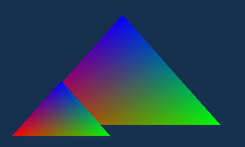

# GL clear / viewport checkpoint — 2026-10-13

Passed in Azahar 2126.1.2/Vulkan with the same settings as the previous gates.
libctru remains the platform backend; the native Rust port replaces Citro3D
renderer responsibilities. C/C++ and a real ctru-rs/cargo-3ds application are
supported. Physical 3DS execution remains unverified.

Implemented: glClearColor, glClearDepth/glClearDepthf, color/depth glClear,
glViewport and the implemented float/integer state queries (clear values,
viewport/max dimensions, matrix mode/matrices/stacks/limits). Unsupported query
names and clear bits return GL errors. Viewport dimensions clamp to the reported
400×240 limit; zero-size/fully offscreen viewports emit no draw. Clears cover the
whole target regardless of viewport; scissor/write-mask/stencil APIs are still
outside the implemented subset. GL clear opens a frame automatically; geometry
and presentation still use the native API until the arrays/VBO checkpoint.

Viewport visibility is cached on state change. Matrix/viewport preparation is
kept outside unchanged-state draw loops. Matrix and viewport packets are emitted
only when dirty or after GPU state restoration. Frames allocate nothing.
Mid-frame clears flush previous commands before the memory fill so draw/clear
ordering is preserved. Depth-only fills use GX slot 0 because libctru's GX queue
counts PSC0 interrupts and ignores PSC1. The first trial caught a hang with a
slot-1-only fill; no incomplete run was accepted. This was fixed before all
three complete comparisons were repeated.

## Verification

- Eleven Rust host tests, C/C++ ABI links and hard-float builds, cargo-3ds Rust
  application build and native executable dependency audits pass.
- Three native C runs, three C-reference runs, one C++ run and three rust3ds
  runs pass all nine workload measurements and the clear-order scene.
- 40 complete 400×240 GPU images agree byte for byte across C, C++ and rust3ds:
  static geometry, changing matrices, changing viewports and the clear-order
  scene. Static/matrix outputs also match the previous checkpoints.
- The scene checks draw→color clear→zero viewport→full draw→depth-only clear→
  subviewport draw. In particular, depth-only clear preserves prior color and
  a color clear removes preceding geometry.
- Seven native consumer runs each check 240 frames and eight init/close cycles:
  56 checked cycles with exact linear/VRAM recovery. Timed runs complete all
  30 warmups + 120 samples per workload. One final scene per run plus four C/C++
  ending frames bring the native total to 11,141 GPU frames.

## CPU ms/frame

Slowest native C/rust3ds runs versus fastest reference runs; GPU/VBlank waiting
is excluded from timed steady-frame CPU work. Rust app results are separate
because direct Cargo/LTO calls optimize differently from C FFI.

| Workload | Draws/frame | C/Citro3D | Native C ABI | rust3ds |
| --- | ---: | ---: | ---: | ---: |
| static | 1 | 0.4244 | 0.3340 | 0.3338 |
| static | 64 | 1.5879 | 0.4072 | 0.3981 |
| static | 512 | 9.8608 | 0.9268 | 0.8542 |
| matrix | 1 | 0.4260 | 0.3363 | 0.3360 |
| matrix | 64 | 2.3439 | 0.5514 | 0.5335 |
| matrix | 512 | 16.0380 | 2.0920 | 1.9488 |
| viewport | 1 | 0.4247 | 0.3350 | 0.3348 |
| viewport | 64 | 2.4752 | 0.4741 | 0.4538 |
| viewport | 512 | 17.1205 | 1.4683 | 1.3060 |

All nine CPU gates pass independently for the C ABI and rust3ds consumer. Native
frame latency remains about 16.712 ms. The C-reference 512-viewport workload
requires 17.1205 ms CPU / 17.1306 ms total; native needs 1.4683 ms (C ABI) or
1.3060 ms (rust3ds). Azahar GPU timing remains nearly constant and cannot
establish physical PICA execution speed.

## Cost relative to the preceding matrix/rust3ds checkpoint

C ABI, same persistent geometry and synchronization:

| Workload | Draws | Previous ms | Current ms | Change |
| --- | ---: | ---: | ---: | ---: |
| static | 1 | 0.3338 | 0.3340 | +0.06% |
| static | 64 | 0.4044 | 0.4072 | +0.69% |
| static | 512 | 0.9056 | 0.9268 | +2.34% |
| matrix | 1 | 0.3359 | 0.3363 | +0.12% |
| matrix | 64 | 0.5383 | 0.5514 | +2.43% |
| matrix | 512 | 1.9870 | 2.0920 | +5.28% |

Rust consumer, separately:

| Workload | Draws | Previous ms | Current ms | Change |
| --- | ---: | ---: | ---: | ---: |
| static | 1 | 0.3335 | 0.3338 | +0.09% |
| static | 64 | 0.3888 | 0.3981 | +2.39% |
| static | 512 | 0.7814 | 0.8542 | +9.32% |
| matrix | 1 | 0.3353 | 0.3360 | +0.21% |
| matrix | 64 | 0.5033 | 0.5335 | +6.00% |
| matrix | 512 | 1.7081 | 1.9488 | +14.09% |

The initial trial's static 512-draw CPU cost was 1.1082 ms; caching viewport
visibility and isolating state preparation reduced it to 0.9268 ms. The final
C-ABI static increase is about 0.0212 ms/frame (2.34%), and the Rust-app static
increase is about 0.0728 ms/frame (9.32%). The matrix-change costs also increase,
as shown above. Keep these costs visible in subsequent comparisons; the new
state functionality preserves the CPU advantage over C rather than improving
every prior workload. Command buffer capacity remains 128 KiB.

## Repeat

Run `native/scripts/check.sh`, then the emulator runner with `--frame-state`,
`--rust3ds-rom` pointing at the Rust consumer's .3dsx, `--runs 3`, and a separate
output directory. Point `--baseline-summary` at the previous checkpoint.
`--resume` reuses complete saved reports and rejects changes to the executable
hashes. `rom-sha256.json` records the exact tested binaries; the summary retains
all measurements, image hashes and both consumers' incremental CPU changes.
